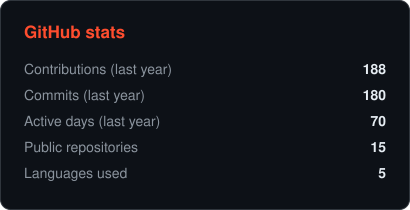
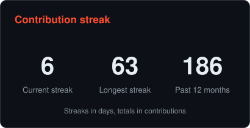
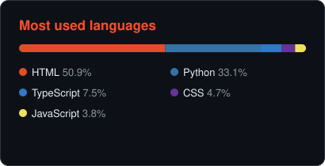
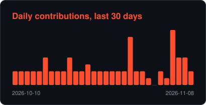
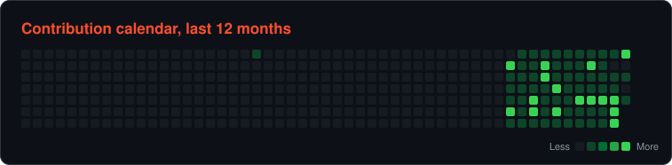

<h1 align="center">Soham Banerjee</h1>
<h4 align="center">MS Computer Science @ USC · Data Science Intern @ H2O.ai · I build ML and retrieval systems, and the data pipelines they run on</h4>

## About Me

- **Now:** Data Science Intern at H2O.ai, building RAG-based test triage (80% less manual review, 90% fewer LLM calls)
- **Studying:** MS Computer Science at USC, graduating May 2027, plus research on model calibration and uncertainty
- **Before:** Software Engineer at Accenture, building Java APIs for 25+ healthcare providers
- **Open to:** ML Engineer and Software Engineer roles
- **Based in:** Los Angeles

> My portfolio has an assistant that answers recruiter questions about my experience, running entirely in your browser. [Try it](https://soham286.github.io/#ask)

## Featured Projects

| Project | What it does | Results and tools |
|---|---|---|
| [**Electricity Demand Forecast Globe**](https://github.com/Soham286/Electricity-Demand-Forecast-Globe) | 48-hour hourly demand forecasts for India and 41 other countries on a [3D globe](https://soham286.github.io/Electricity-Demand-Forecast-Globe/) | All-India hourly error 3.5% vs 5.7% baseline · LightGBM, pandas, Three.js |
| [**PL Transfer Value**](https://github.com/Soham286/pl-transfer-value) | Estimates football players' market values, with SHAP explanations in a Streamlit app | R² 0.80 and €2.76M MAE on a held-out season · XGBoost, scikit-learn, SHAP |
| [**Academic Document Analyzer**](https://github.com/Soham286/academic-document-analyzer) | Explainable RAG that answers questions over documents with source citations | 5,000+ chunks, evaluated with RAGAS · Sentence-BERT, FAISS |
| [**E-Commerce Medallion Pipeline**](https://github.com/Soham286/ecommerce-medallion-pipeline) | Bronze, Silver and Gold data pipeline | 10M+ daily records, 45% higher throughput · Databricks, PySpark, Airflow |
| [**DSA Mastery Agent**](https://github.com/Soham286/leetcode-daily-agent) | Emails daily coding problems and tracks progress on a [live dashboard](https://soham-dsa-mastery.streamlit.app/) | Runs on GitHub Actions · Python, Streamlit |

## Tools and Frameworks

  
  
  
  
  
  
  
  
  
  
  
  
  
  
  

<b>Also:</b> RAG, embeddings, FAISS, Sentence-BERT, XGBoost, LightGBM, SHAP, Databricks, Delta Lake, Airflow, Spring Boot, SQL

## GitHub Stats

<table align="center">
  <tr>
    <td align="center"></td>
    <td align="center"></td>
  </tr>
  <tr>
    <td align="center"></td>
    <td align="center"></td>
  </tr>
</table>

## Contribution Calendar

  

## Contribution Pacman

  <picture>
    <source media="(prefers-color-scheme: dark)" srcset="https://raw.githubusercontent.com/Soham286/Soham286/output-pacman/pacman-contribution-graph-dark.svg" />
    <source media="(prefers-color-scheme: light)" srcset="https://raw.githubusercontent.com/Soham286/Soham286/output-pacman/pacman-contribution-graph.svg" />
    
  </picture>

